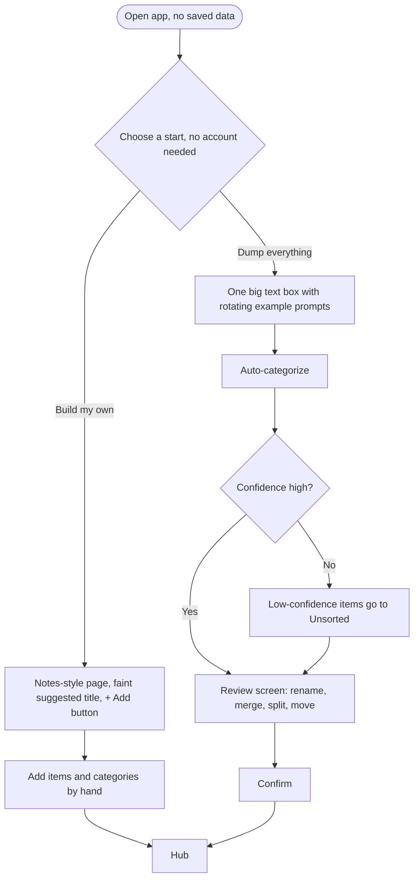
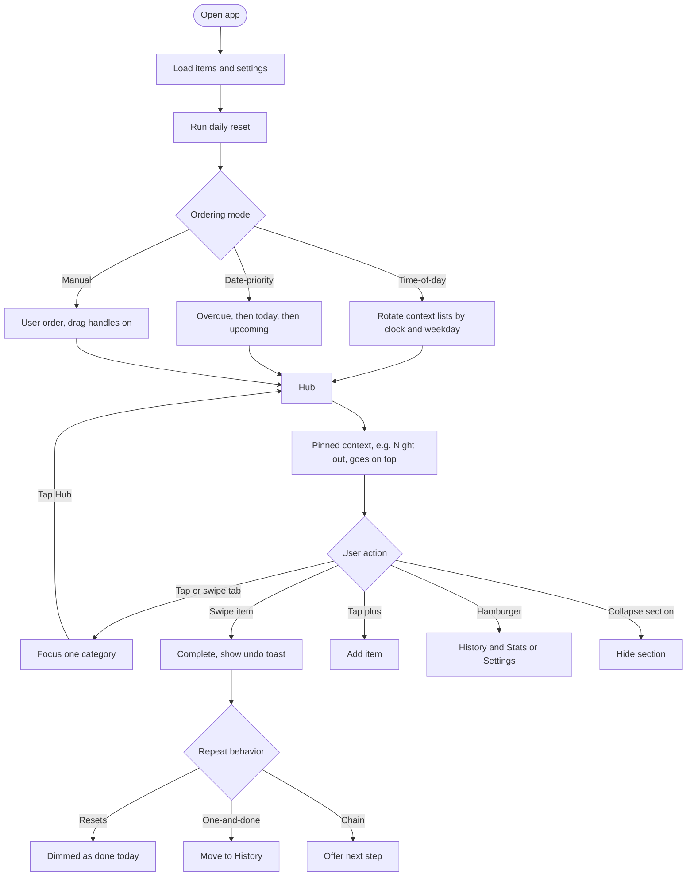
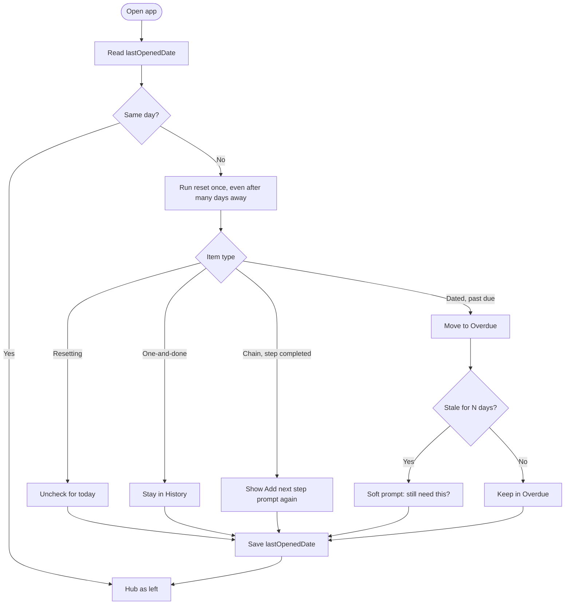

# Don't Forget…!

A dynamic hub for the tasks, items, and events you'd normally forget but still need to do. It adapts to the time of day, stays easy to scan, and keeps the user in control: time-of-day ordering, date-priority ordering, or fully manual.

- [brainstorming.md](brainstorming.md): steps, states, errors, and the main/return visit details
- [flows.md](flows.md): all diagrams, including the item lifecycle and error paths

## Flows

### First visit



### Main visit



### Return visit and daily reset



These are copies of the diagrams in [flows.md](flows.md), since GitHub can't include one Markdown file in another. Update both together.

## Status

First iteration. Working: first visit (build or dump, with review screen), hub with tabs and collapsible lists, "+ Add", swipe or tap to complete with undo, chain "Next step", daily reset on return, History & Stats with a pie chart, and the three ordering modes in Settings. Not yet: dragging individual items (only lists reorder, in "My own order" mode), weekend lists, notifications, sync.

To replay the first visit, open the menu, then Settings, then "Erase everything".

## Getting started

Built with Next.js (App Router, TypeScript). Data is stored locally in the browser for v1.

```bash
npm install
npm run dev
```

Open [http://localhost:3000](http://localhost:3000).
