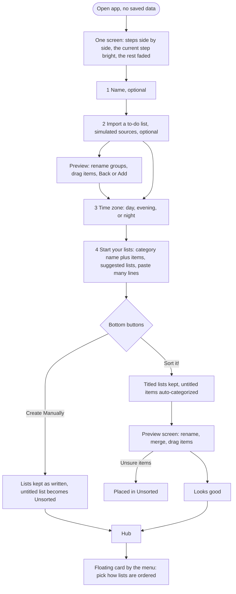

# Don't Forget…!

A dynamic hub for the tasks, items, and events you'd normally forget but still need to do. It adapts to the time of day, stays easy to scan, and keeps the user in control: time-of-day ordering, date-priority ordering, or fully manual.

- [brainstorming.md](brainstorming.md): steps, states, errors, and the main/return visit details
- [flows.md](flows.md): all diagrams, including the item lifecycle and error paths

## Flows

### First visit



### Main visit


### Return visit and daily reset


These are copies of the diagrams in [flows.md](flows.md), since GitHub can't include one Markdown file in another. Update both together.

## Status

First iteration. Working: first visit (one onboarding screen with skippable steps for name, import, time zone, and a list editor with Sort it! or Create Manually), hub with tabs and collapsible lists, "+ Add" menu at the top (auto-categorize new items, add a list, or add to a list), suggested lists, swipe or tap to complete with undo, chain "Next step", daily reset on return, History & Stats with a pie chart, and the three ordering modes in Settings. Importing is simulated (made-up tasks, no real accounts). Items can be dragged within a list or between lists (drag the grip, drop on an item, a list, or a tab) with a mouse, or moved with the keyboard (focus the grip, then arrow keys; Shift+arrow changes list). Touch-screen drag is not built yet. A paper to-do list look with little drawings (4 font pairings and 4 layouts to choose from in Settings). Forms show errors beside the field and keep what you typed; keyboard access, real labels, and text contrast were checked (zero axe-core violations on 11 screens). Also working: confetti and an "All done" state when a list is cleared, a welcome card after onboarding, a Completed tab, a progress pie on the hub, and typing straight into any list. Not yet: weekend lists, notifications, sync.

To replay the first visit, open the menu, then Settings, then "Erase everything".

## Getting started

Built with Next.js (App Router, TypeScript). Data is stored locally in the browser for v1.

```bash
npm install
npm run dev
```

Open [http://localhost:3000](http://localhost:3000).

## Usability test: a new user on the live site

**What this is.** A walkthrough of https://dont-forget-six.vercel.app/ on 2026-10-20, done as a brand-new user named Maya, by Claude driving a real browser (Edge) with a script and reviewing screenshots. It is a careful first-pass review, not research with real people. Where it says "later", the browser clock was moved forward 1 and 4 days to simulate coming back. Not covered: a physical phone, real touch, and a screen reader.

**What Maya did.**
1. **First visit.** Typed a name, looked at an import preview and backed out, used "Use my location", then typed four things in four different areas of life and pressed **Sort it!**: "buy oat milk and eggs", "submit internship application due friday", "call mom about thanksgiving flights", "take the dog to the vet".
2. **Main tasks.** Checked an item off, added an item with **+ Add**, used a list's quick "Add an item" row, opened the edit sheet, switched to **By date**, and looked at Completed and History.
3. **Coming back.** Reloaded the same day, then returned 1 day and 4 days later. A second run set up a repeating routine ("take vitamins") and checked it was fresh the next day.

### What worked

- **The first screen explains itself.** One sentence says what the tool is, all four steps are visible at once with only the current one bright, and the cursor is already in the name box. Page load took about 1 second with no console errors.
- **Enter carries you through.** Name, Enter, skip, continue, type items with Enter: no mouse needed. Pressing **Sort it!** with nothing typed gave a clear message beside the button ("Add at least one item first: type it in the box above and press Enter.").
- **A date in the words just works.** "...due friday" became a "Fri, Oct 23" chip with no date picking. Four days later the same item showed "! Overdue", a tinted row, and "! 1 overdue" at the top.
- **Coming back is safe.** Same-day reload kept everything, including the order mode, and did not show the welcome card again. The repeating "take vitamins" was checked off, then unchecked the next day.
- **The Add menu is clear.** Its three choices ("Add new items and auto-categorize", "Add new list", "Add items to list") say what each does.
- **Getting started is quick.** About 11 actions from landing to a sorted hub with four items (16 in this run, because of a few exploratory clicks).

### Problems found, most important first

| # | Problem | What happened | Suggested fix |
|---|---|---|---|
| 1 | **Sort it! misses everyday things** | "buy oat milk and eggs" went to **Unsorted** even though "Groceries" is one of the suggested lists. In the Apple Reminders import preview, 2 of 5 tasks ("Pick up dry cleaning", "Renew passport") also landed in Unsorted. 3 of 4 typed items were filed correctly. | Teach the sorter common words for groceries, errands, health, and home. Show "Unsorted" as "Needs a home" with a friendly nudge to drag items. |
| 2 | **+ Add quietly files into the first list** | "renew passport" was added from the Add sheet and landed in **Unsorted**, because the first list is pre-selected. Nothing asked where it should go. | Guess the list from the words (the same sorter), or open with no list chosen and ask. |
| 3 | **Repeating is easy to miss** | A list called "Morning routine" made one-time items. Only lists named like "Leaving the house" repeat automatically. Maya had to find the pencil, then "Every day". Nothing on the list hints that repeating exists. | Ask "Repeat every day?" when a list is created (or guess from words like "morning", "daily", "routine") and show the repeat arrows on rows from the start. |
| 4 | **The welcome card covers what you came for** | On first arrival the "You're all set" card sits over the greeting, the tabs, and the first list, and the confetti drifts across its text while you read it. | Show the card to the side or below the title, and start the confetti after it has been read or dismissed. |
| 5 | **A leftover message sits on top of a dialog** | The "Unsorted is all done!" message was still on screen when the Add sheet opened, and covered the hint under the date field. | Hide any message when a dialog opens. |
| 6 | **The celebration fires too easily** | Checking off the only item in a one-item list counted as "all done" and set off confetti, including for "Unsorted", a list Maya never made. With four one-item lists the celebration happens four times. The toast also offers "Next step" with no explanation. | Celebrate only lists with 2 or more items done today, skip Unsorted, and rename "Next step" to "Add a follow-up". |
| 7 | **Coming back looks the same** | After 1 day and after 4 days the page opens exactly like before, apart from the greeting. The 4-day gap only shows through an overdue item. | A short line on return, like "Welcome back. 1 overdue, 2 repeating items are fresh for today." |
| 8 | **A couple of small targets on a phone** | On the first phone screen, "Skip to my lists" is 32 px tall (the usual minimum is 44 px). Only the first screen was measured. | Make it a larger button, then measure the hub's pencil and drag handles. |

### Smaller notes

- On a phone the first screen is about 2300 px tall because the four steps stack, with steps 2 to 4 faded below. It is clear, but a short "step 1 of 4" cue would help.
- On a 1280 by 800 laptop screen the fourth step just fits at the bottom.
- The "Use my location" result text could not be confirmed in this run (the check was inconclusive). Worth a quick manual look.

### Not yet tested

A real phone, real touch dragging (browser drag-and-drop does not run on touch), a screen reader, and slow or offline connections. None of the problems above has been fixed yet.

