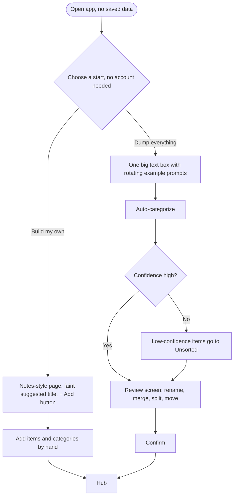
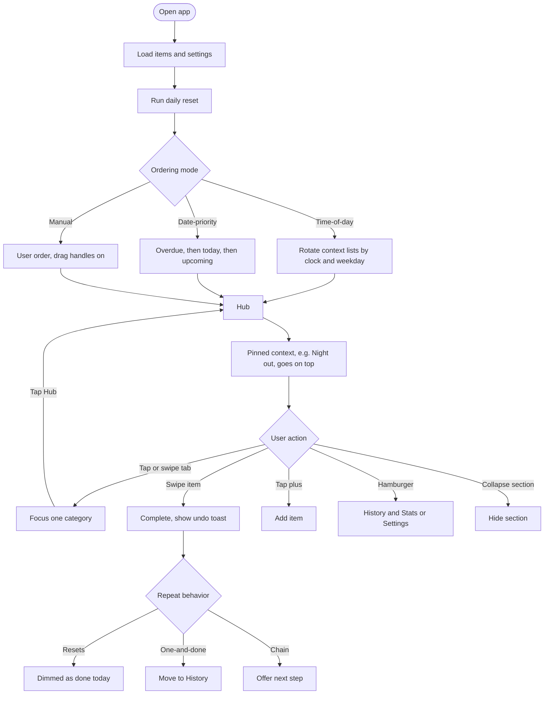
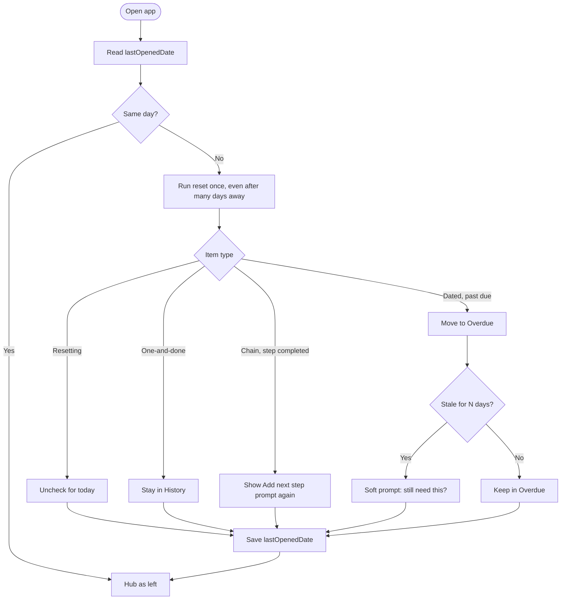
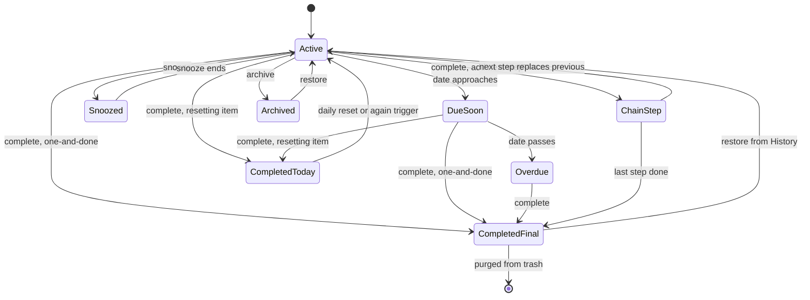
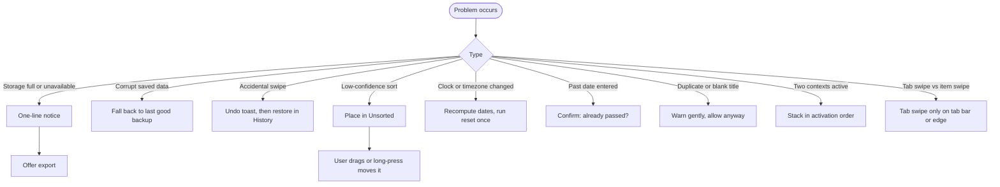

# Don't Forget…! — Flows

Diagrams for the app's main flows. Source of truth for behavior is [brainstorming.md](brainstorming.md).

## 1. First visit

## 2. Main visit

## 3. Return visit and daily reset

## 4. Item lifecycle

## 5. Errors and edge cases

